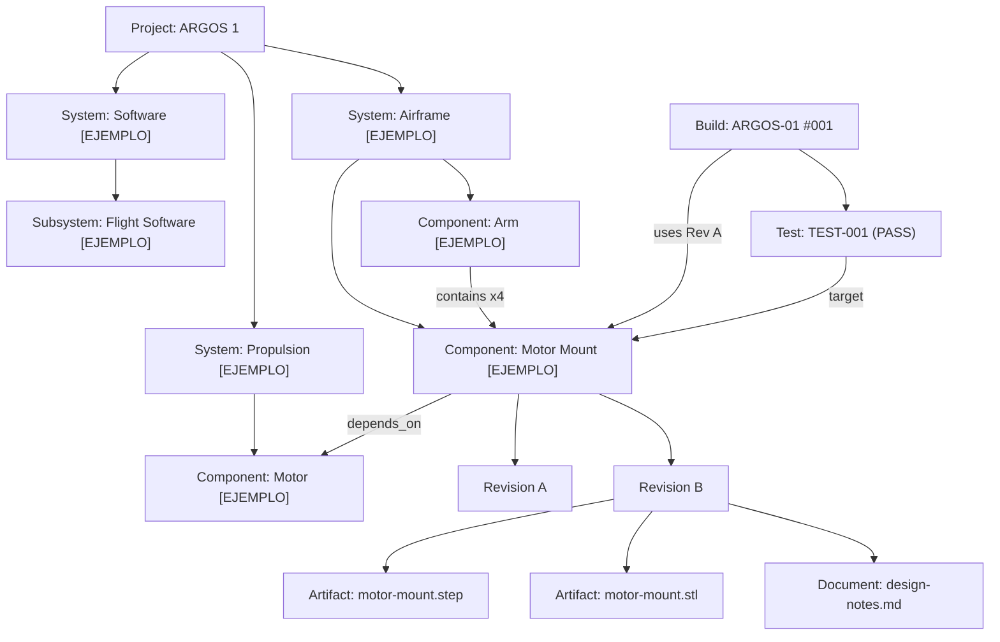

# ARGOS_SYSTEM_MODEL_DIAGRAM.md — Fase 1

Diagrama visual del modelo conceptual (Mermaid). Todos los nombres de
componentes son `[EJEMPLO]` — ilustran el modelo, no representan
inventario real confirmado (ver `CURRENT_COMPONENTS.md`).

## Lectura del diagrama

- `Project → System → Subsystem → Component` es la jerarquía de
  navegación (System Explorer, Fase 9).
- `Component → Revision → Artifact/Document` es la cadena versionada.
- `depends_on` y `contains` son aristas horizontales entre Components,
  independientes de la jerarquía de navegación.
- `Build` congela qué `Revision` de cada `Component` se usó; `Test`
  cuelga de `Build` y/o `Component`.
