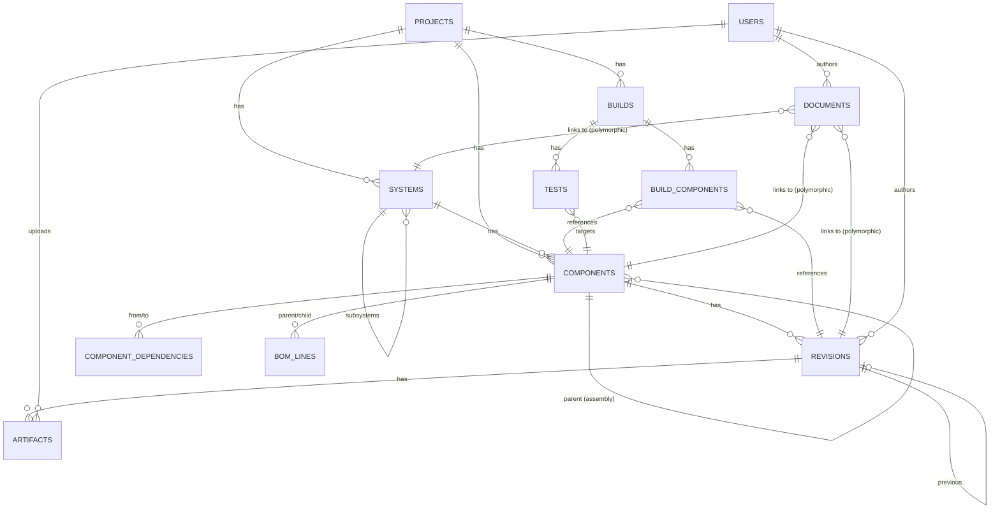

# DATABASE_SCHEMA.md — Fase 2

Esquema PostgreSQL propuesto para el MVP. Refleja exactamente las
entidades "MVP" de `ENTITY_CATALOG.md`. Este documento es la fuente de
verdad; `platform/app/prisma/schema.prisma` (Fase 9) es su implementación
en Prisma.

## Convenciones

- PK: `id UUID DEFAULT gen_random_uuid()` en todas las tablas (extensión
  `pgcrypto` o `uuid-ossp`).
- Timestamps: `created_at TIMESTAMPTZ NOT NULL DEFAULT now()`, y
  `updated_at TIMESTAMPTZ NOT NULL DEFAULT now()` donde aplica mutación.
- Enums de Postgres para campos de estado cerrado.
- `search_vector tsvector` en las tablas indexadas por búsqueda global
  (Component, Document), mantenido por trigger.

## Tablas

### users
| Columna | Tipo | Notas |
|---|---|---|
| id | UUID PK | |
| email | TEXT UNIQUE NOT NULL | |
| name | TEXT NOT NULL | |
| password_hash | TEXT NOT NULL | auth por credenciales |
| role | user_role NOT NULL DEFAULT 'MEMBER' | enum: ADMIN, MEMBER, VIEWER |
| created_at | TIMESTAMPTZ | |

### projects
| Columna | Tipo | Notas |
|---|---|---|
| id | UUID PK | |
| name | TEXT NOT NULL | único activo: `ARGOS 1` |
| description | TEXT | |
| status | project_status NOT NULL DEFAULT 'ACTIVE' | enum: ACTIVE, ARCHIVED |
| created_at | TIMESTAMPTZ | |
| updated_at | TIMESTAMPTZ | |

### systems
| Columna | Tipo | Notas |
|---|---|---|
| id | UUID PK | |
| project_id | UUID NOT NULL REFERENCES projects(id) ON DELETE CASCADE | |
| parent_system_id | UUID NULL REFERENCES systems(id) ON DELETE CASCADE | self-ref, para Subsystem |
| name | TEXT NOT NULL | |
| description | TEXT | |
| status | entity_status NOT NULL DEFAULT 'ACTIVE' | enum: ACTIVE, DEPRECATED |
| created_at | TIMESTAMPTZ | |
| updated_at | TIMESTAMPTZ | |

Index: `(project_id)`, `(parent_system_id)`.
Constraint: `parent_system_id` debe pertenecer al mismo `project_id`
(chequeado en aplicación; Postgres no lo expresa fácil sin trigger).

### components
| Columna | Tipo | Notas |
|---|---|---|
| id | UUID PK | |
| project_id | UUID NOT NULL REFERENCES projects(id) ON DELETE CASCADE | denormalizado para queries directas |
| parent_system_id | UUID NULL REFERENCES systems(id) | uno de los dos parent_* es NOT NULL (constraint CHECK) |
| parent_component_id | UUID NULL REFERENCES components(id) | para sub-componentes / assemblies |
| name | TEXT NOT NULL | |
| type | component_type NOT NULL | enum: HARDWARE, SOFTWARE, ASSEMBLY |
| description | TEXT | |
| status | component_status NOT NULL DEFAULT 'DRAFT' | enum: DRAFT, DESIGN, PROTOTYPE, TESTING, VALIDATED, RELEASED, DEPRECATED |
| current_revision_id | UUID NULL REFERENCES revisions(id) | FK diferida (revisions referencia components) — se agrega con ALTER TABLE tras crear revisions |
| owner_id | UUID NULL REFERENCES users(id) | |
| search_vector | TSVECTOR | generado de name + description |
| created_at | TIMESTAMPTZ | |
| updated_at | TIMESTAMPTZ | |

Constraint: `CHECK (parent_system_id IS NOT NULL OR parent_component_id IS NOT NULL)`.
Index: `(project_id)`, `(parent_system_id)`, `(parent_component_id)`,
GIN `(search_vector)`.

### revisions
| Columna | Tipo | Notas |
|---|---|---|
| id | UUID PK | |
| component_id | UUID NOT NULL REFERENCES components(id) ON DELETE CASCADE | |
| label | TEXT NOT NULL | ej. "A", "B", "0.3" |
| status | revision_status NOT NULL DEFAULT 'DRAFT' | enum: DRAFT, RELEASED, DEPRECATED |
| description | TEXT | |
| change_summary | TEXT | qué cambió respecto a la anterior |
| author_id | UUID NOT NULL REFERENCES users(id) | |
| previous_revision_id | UUID NULL REFERENCES revisions(id) | cadena de historial |
| created_at | TIMESTAMPTZ NOT NULL DEFAULT now() | inmutable, no hay updated_at |

Constraint: `UNIQUE (component_id, label)`.
Index: `(component_id)`.
Regla de aplicación (no de DB): nunca hacer `UPDATE` sobre una fila
existente de `revisions` salvo el campo `status` (DRAFT→RELEASED→
DEPRECATED); todo cambio de contenido crea una fila nueva.

### artifacts
| Columna | Tipo | Notas |
|---|---|---|
| id | UUID PK | |
| revision_id | UUID NOT NULL REFERENCES revisions(id) ON DELETE CASCADE | |
| filename | TEXT NOT NULL | |
| file_type | TEXT NOT NULL | extensión normalizada: step, stl, 3mf, pdf, etc. |
| size_bytes | BIGINT NOT NULL | |
| checksum | TEXT NOT NULL | sha256 |
| storage_key | TEXT NOT NULL | ruta/key en el storage abstraído (ver `ARTIFACT_MODEL.md`) |
| uploaded_by | UUID NOT NULL REFERENCES users(id) | |
| uploaded_at | TIMESTAMPTZ NOT NULL DEFAULT now() | |

Index: `(revision_id)`.

### documents
| Columna | Tipo | Notas |
|---|---|---|
| id | UUID PK | |
| title | TEXT NOT NULL | |
| content_markdown | TEXT NOT NULL | |
| entity_type | document_entity_type NOT NULL | enum: SYSTEM, COMPONENT, REVISION, BUILD, TEST |
| entity_id | UUID NOT NULL | FK polimórfica, sin constraint de DB (validada en app) |
| status | document_status NOT NULL DEFAULT 'DRAFT' | enum: DRAFT, PUBLISHED |
| author_id | UUID NOT NULL REFERENCES users(id) | |
| search_vector | TSVECTOR | generado de title + content_markdown |
| created_at | TIMESTAMPTZ | |
| updated_at | TIMESTAMPTZ | |

Index: `(entity_type, entity_id)`, GIN `(search_vector)`.

### component_dependencies
| Columna | Tipo | Notas |
|---|---|---|
| id | UUID PK | |
| from_component_id | UUID NOT NULL REFERENCES components(id) ON DELETE CASCADE | |
| to_component_id | UUID NOT NULL REFERENCES components(id) ON DELETE CASCADE | |
| type | dependency_type NOT NULL | enum: DEPENDS_ON, CONTAINS, COMPATIBLE_WITH |
| notes | TEXT | |
| created_at | TIMESTAMPTZ | |

Constraint: `UNIQUE (from_component_id, to_component_id, type)`,
`CHECK (from_component_id <> to_component_id)`.
Index: `(from_component_id)`, `(to_component_id)`.

### bom_lines
| Columna | Tipo | Notas |
|---|---|---|
| id | UUID PK | |
| parent_component_id | UUID NOT NULL REFERENCES components(id) ON DELETE CASCADE | |
| child_component_id | UUID NOT NULL REFERENCES components(id) ON DELETE CASCADE | |
| quantity | INTEGER NOT NULL DEFAULT 1 CHECK (quantity > 0) | |
| child_revision_id | UUID NULL REFERENCES revisions(id) | NULL = "usar current_revision al momento de consultar" |
| created_at | TIMESTAMPTZ | |

Constraint: `UNIQUE (parent_component_id, child_component_id)`,
`CHECK (parent_component_id <> child_component_id)`.
Nota: `bom_lines` es semánticamente `component_dependencies` con
`type='CONTAINS'` + cantidad; se separa en tabla propia por el campo
`quantity`, que no aplica a `depends_on`/`compatible_with`.

### builds
| Columna | Tipo | Notas |
|---|---|---|
| id | UUID PK | |
| project_id | UUID NOT NULL REFERENCES projects(id) ON DELETE CASCADE | |
| code | TEXT NOT NULL | ej. "ARGOS-01 Build #001" |
| description | TEXT | |
| status | build_status NOT NULL DEFAULT 'PLANNED' | enum: PLANNED, ASSEMBLED, TESTING, ARCHIVED |
| created_at | TIMESTAMPTZ | |

Constraint: `UNIQUE (project_id, code)`.

### build_components
| Columna | Tipo | Notas |
|---|---|---|
| id | UUID PK | |
| build_id | UUID NOT NULL REFERENCES builds(id) ON DELETE CASCADE | |
| component_id | UUID NOT NULL REFERENCES components(id) | |
| revision_id | UUID NOT NULL REFERENCES revisions(id) | revisión exacta usada — congelada |

Constraint: `UNIQUE (build_id, component_id)`.
Index: `(build_id)`, `(component_id)`.

### tests
| Columna | Tipo | Notas |
|---|---|---|
| id | UUID PK | |
| name | TEXT NOT NULL | |
| target_component_id | UUID NOT NULL REFERENCES components(id) | |
| build_id | UUID NULL REFERENCES builds(id) | nullable: un test puede no estar atado a un build específico |
| description | TEXT | |
| result | test_result NOT NULL DEFAULT 'INCONCLUSIVE' | enum: PASS, FAIL, INCONCLUSIVE |
| notes | TEXT | |
| date | DATE NOT NULL | |
| created_by | UUID NOT NULL REFERENCES users(id) | |
| created_at | TIMESTAMPTZ | |

Index: `(target_component_id)`, `(build_id)`.
Evidence: se modela como `artifacts` con `revision_id` NULL no permitido
por FK actual → en su lugar, evidencia de test se sube como `Document`
o `Artifact` enlazado vía `documents.entity_type='TEST'`.

## Enums

```sql
CREATE TYPE user_role AS ENUM ('ADMIN', 'MEMBER', 'VIEWER');
CREATE TYPE project_status AS ENUM ('ACTIVE', 'ARCHIVED');
CREATE TYPE entity_status AS ENUM ('ACTIVE', 'DEPRECATED');
CREATE TYPE component_type AS ENUM ('HARDWARE', 'SOFTWARE', 'ASSEMBLY');
CREATE TYPE component_status AS ENUM ('DRAFT','DESIGN','PROTOTYPE','TESTING','VALIDATED','RELEASED','DEPRECATED');
CREATE TYPE revision_status AS ENUM ('DRAFT', 'RELEASED', 'DEPRECATED');
CREATE TYPE document_entity_type AS ENUM ('SYSTEM','COMPONENT','REVISION','BUILD','TEST');
CREATE TYPE document_status AS ENUM ('DRAFT', 'PUBLISHED');
CREATE TYPE dependency_type AS ENUM ('DEPENDS_ON', 'CONTAINS', 'COMPATIBLE_WITH');
CREATE TYPE build_status AS ENUM ('PLANNED', 'ASSEMBLED', 'TESTING', 'ARCHIVED');
CREATE TYPE test_result AS ENUM ('PASS', 'FAIL', 'INCONCLUSIVE');
```

## ERD



## Búsqueda (Fase 11 del segundo bloque, cubierta acá)

`search_vector` en `components` y `documents`, actualizado por trigger
`BEFORE INSERT OR UPDATE`:

```sql
CREATE FUNCTION components_search_vector_update() RETURNS trigger AS $$
BEGIN
  NEW.search_vector :=
    setweight(to_tsvector('spanish', coalesce(NEW.name,'')), 'A') ||
    setweight(to_tsvector('spanish', coalesce(NEW.description,'')), 'B');
  RETURN NEW;
END;
$$ LANGUAGE plpgsql;
```

Búsqueda semántica (pgvector) queda explícitamente fuera del MVP (regla
del usuario: "Semantic/vector search is OPTIONAL for the first
iteration"). El schema no incluye columnas de embeddings todavía.
